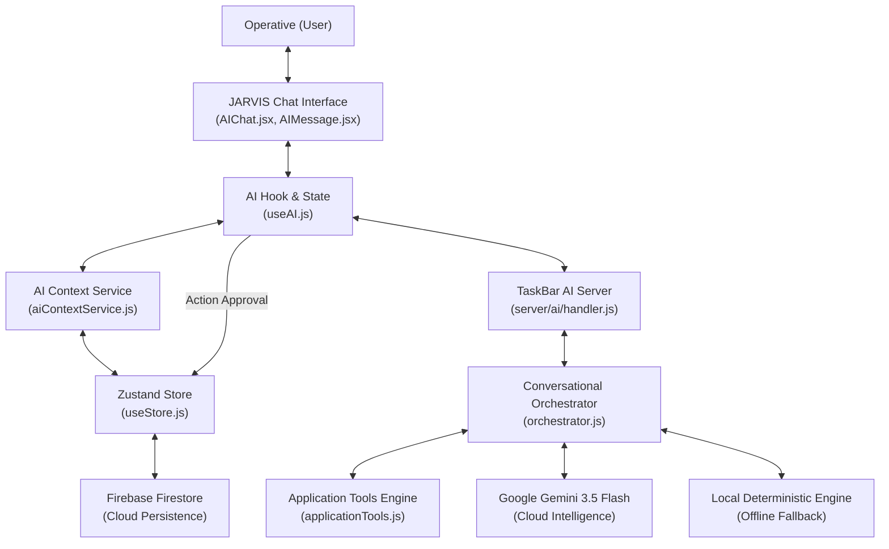

# TASKBAR OS — JARVIS INTELLIGENCE REGISTRY & MODULE SPECIFICATION

This document details the architectural blueprint, data schema, available read/write operations, analytics, security parameters, synchronization lifecycle, and integration gaps across all application modules in **TaskBar OS** connected to the **JARVIS Central Intelligence Engine**.

---

## 1. Core Architecture Overview

JARVIS serves as the unified intelligence plane of TaskBar OS. Rather than operating as an isolated chatbot, JARVIS interfaces with both client-side Zustand state (`src/store/useStore.js`) and the backend intelligence server (`server/ai/orchestrator.js` and `server/ai/tools/applicationTools.js`).

---

## 2. Comprehensive Module Registry

### 2.1 Tasks Module
- **Store Path**: `state.tasks[dateStr]` (Array of Task objects)
- **Task Schema**:
  - `id` (UUID string)
  - `title` (string)
  - `description` (string)
  - `priority` ('High' | 'Medium' | 'Low')
  - `category` ('Work' | 'Personal' | 'Health' | 'Learning' | 'Creative' | 'Social' | 'Finance' | 'Other')
  - `dueTime` (HH:MM AM/PM string or empty)
  - `completed` (boolean)
  - `progress` (number 0-100)
  - `createdAt` (ISO string)
  - `completedAt` (ISO string | null)
  - `date` (YYYY-MM-DD string)
  - `order` (number)
  - `isRoutine` (boolean)
  - `routineId` (UUID string | null)
  - `timeTaken` (number of focus seconds)
  - `estimatedTime` (number of minutes)
- **Available Read Operations**:
  - `getTasks({ date, status, priority, category })`
  - `getPendingTasks({ date })`
  - `getCompletedTasks({ date })`
  - `getOverdueTasks()`
  - `getTaskStatistics({ days })`
- **Available Write Operations**:
  - `addTask(taskData, date)`
  - `updateTask(taskId, date, updates)`
  - `deleteTask(taskId, date)`
  - `duplicateTask(taskId, date)`
  - `reorderTasks(date, orderedIds)`
  - `toggleTaskComplete(taskId, date)`
  - `postponeTask(taskId, fromDate, toDate)`
  - `resetDayTasks(date)`
- **Available Analytics**:
  - Daily & weekly completion rates, overdue backlogs, category distributions, priority breakdowns, focus time logged per task.
- **Authentication & Security**: Read/Write permitted in Guest Mode (localStorage) and Authenticated Mode (Firestore per UID).
- **Data Freshness & Sync**: Real-time state mutation with debounced (5s) Firestore push when authenticated.
- **JARVIS Integration Status**: Deeply connected. Reads tasks dynamically and proposes task creation with user approval.

---

### 2.2 Habits Module
- **Store Path**: `state.habits` (Array), `state.habitLogs[dateStr][habitId]` (boolean)
- **Habit Schema**:
  - `id` (string e.g. 'h1')
  - `name` / `title` (string)
  - `icon` (string emoji)
  - `color` (hex string)
  - `category` (string)
  - `target` (number)
  - `unit` (string)
  - `frequency` ('daily' | 'weekdays' | 'custom')
  - `scheduledDays` (Array of numbers 0-6)
  - `archived` (boolean)
  - `createdAt` (ISO string)
  - `streak` (derived integer)
- **Available Read Operations**:
  - `getHabits()`
  - `getHabitStreaks()`
  - `getHabitLogs({ habitId, days })`
- **Available Write Operations**:
  - `addHabit(habitData)`
  - `updateHabit(id, updates)`
  - `deleteHabit(id)`
  - `toggleArchiveHabit(id)`
  - `logHabit(habitId, date, completed)`
- **Available Analytics**:
  - Current streak, best streak, completion consistency percentage, scheduled vs completed ratio.
- **JARVIS Integration Status**: Integrated. JARVIS queries active streaks and can propose logging habits.

---

### 2.3 Routines Module
- **Store Path**: `state.routines` (Array), `state.appliedRoutines[dateStr]` (boolean)
- **Routine Schema**:
  - `id` (UUID string)
  - `title` (string)
  - `description` (string)
  - `priority` (string)
  - `category` (string)
  - `dueTime` (string)
  - `days` (Array of numbers 0-6)
  - `enabled` (boolean)
  - `createdAt` (ISO string)
- **Available Read Operations**:
  - `getRoutines()`
  - `getRoutineDetails({ routineId })`
  - `getRoutineStats()`
- **Available Write Operations**:
  - `addRoutine(data)`
  - `updateRoutine(id, updates)`
  - `deleteRoutine(id)`
  - `toggleRoutine(id)`
  - `applyRoutinesToDate(date)`
- **Available Analytics**:
  - Total routine protocols, active protocols, routine tasks completed vs generated.
- **JARVIS Integration Status**: Upgraded. JARVIS connects routines to daily planning and verifies morning discipline.

---

### 2.4 Gym & Workout Tracking
- **Store Path**: `state.workouts[dateStr]`, `state.exerciseLibrary`, `state.personalRecords`, `state.gymSchedule`
- **Workout Schema**:
  - `name` (string e.g. "Chest + Abs (Strength)")
  - `completed` (boolean)
  - `estimatedCalories` (number)
  - `exercises`: Array of `{ id, name, muscle, sets: [{ id, weight, reps, completed }] }`
- **Available Read Operations**:
  - `getWorkoutHistory({ days })`
  - `getWorkoutDetails({ date })`
  - `getExerciseHistory({ exerciseName })`
  - `getPersonalRecords()`
  - `getWorkoutStatus(date)`
- **Available Write Operations**:
  - `applyGymScheduleForDate(date)`
  - `applyTemplate(date, template)`
  - `addExerciseToWorkout(date, exercise)`
  - `removeExerciseFromWorkout(date, exId)`
  - `addSet(date, exId)`
  - `removeSet(date, exId, setId)`
  - `updateSet(date, exId, setId, updates)`
  - `completeGymSet(date, exerciseId, setId)`
  - `uncompleteGymSet(date, exerciseId, setId)`
  - `completeWorkout(date)`
  - `resetWorkout(date)`
- **Available Analytics**:
  - Total volume moved (kg), total sets completed, estimated calorie expenditure, muscle group frequency, PR progression.
- **JARVIS Integration Status**: Deeply connected. Analyzes training volume, historical sessions, and recovery balance.

---

### 2.5 Diet & Meal Tracking (Nutrition Engine)
- **Store Path**: `state.dietEntries[dateStr]`, `state.dietGoals`, `state.customFoods`, `state.savedMeals`
- **Diet Entry Schema**:
  - `id` (UUID)
  - `name` (string)
  - `mealType` ('breakfast' | 'lunch' | 'dinner' | 'snack')
  - `quantityGrams` (number)
  - `calculatedNutrients`: `{ calories, protein, carbs, fat, fiber }`
- **Available Read Operations**:
  - `getFoodEntries({ date })`
  - `getNutritionStatistics({ days })`
  - `getSavedMeals()`
  - `getDietGoals()`
- **Available Write Operations**:
  - `addDietEntry(entryData, date)`
  - `updateDietEntry(entryId, date, updates)`
  - `deleteDietEntry(entryId, date)`
  - `addCustomFood(foodData)`
  - `saveMealTemplate(mealData)`
  - `updateDietGoals(goalsData)`
- **Available Analytics**:
  - Calorie balance vs target, macronutrient distributions (protein, carbs, fat), nutrient density, protein timing post-workout.
- **JARVIS Integration Status**: Deeply connected. Cites actual macros, identifies protein deficits, and guides meal logging.

---

### 2.6 Focus & Pomodoro
- **Store Path**: `state.pomodoro`, `state.settings.pomodoroFocus`, `state.settings.pomodoroShortBreak`
- **Pomodoro Schema**:
  - `running` (boolean)
  - `mode` ('focus' | 'short-break' | 'long-break')
  - `timeLeft` (seconds)
  - `totalDuration` (seconds)
  - `targetEndTime` (timestamp | null)
  - `sessions` (number)
  - `linkedTaskId` (UUID | null)
  - `history` (Array of session logs)
  - `totalFocusSeconds` (number)
- **Available Read Operations**:
  - `getFocusStatistics()`
  - `getPomodoroState()`
  - `getFocusHistory({ days })`
- **Available Write Operations**:
  - `startPomodoro(mode, durationMinutes, linkedTaskId)`
  - `pausePomodoro()`
  - `resumePomodoro()`
  - `resetPomodoro()`
  - `completePomodoroSession(sessionId)`
  - `skipPomodoroSession()`
- **Available Analytics**:
  - Total deep focus minutes, Pomodoro cycle count, task-linked focus efficiency, focus-to-break ratio.
- **JARVIS Integration Status**: Integrated. JARVIS can recommend focus blocks and initiate sessions upon user confirmation.

---

### 2.7 Wellness & Health (Hydration, Sleep, Mood, Energy, Steps)
- **Store Path**:
  - Hydration: `state.waterLogs[dateStr]`, `state.waterSchedule`, `state.waterCompletions[dateStr]`, `state.waterGoal`
  - Sleep: `state.sleepLogs[dateStr]` (`{ hours, quality, deepSleepHours, notes }`)
  - Mood: `state.moodLogs[dateStr]` (`{ mood, note }`)
  - Energy: `state.energyLogs[dateStr]` (`{ [time]: level }`)
  - Steps / Walking: `state.walkingLogs[dateStr]` (Array of `{ id, steps, distanceKm, durationMinutes, estimatedCalories }`)
  - Body Metrics: `state.bodyMetrics[dateStr]` (`{ weight, bodyFat, chest, waist, biceps, notes }`)
- **Available Read Operations**:
  - `getHydrationStats({ date })`
  - `getSleepLogs({ days })`
  - `getMoodAndEnergy({ date })`
  - `getBodyMetrics({ date })`
  - `getWalkingActivity({ date })`
- **Available Write Operations**:
  - `logWater(date, glasses)`
  - `setWaterGoal(goal)`
  - `toggleWaterScheduleItem(date, itemId)`
  - `logSleep(date, data)`
  - `logMood(date, mood, note)`
  - `logEnergy(date, time, level)`
  - `logWalkingActivity(param1, param2)`
  - `logBodyMetrics(date, data)`
- **Available Analytics**:
  - Daily hydration % of target, 7-day average sleep duration, sleep quality correlation, step target completion, weight trajectory.
- **JARVIS Integration Status**: Upgraded. Health and recovery metrics are fully accessible to the intelligence orchestrator.

---

### 2.8 Cross-Module Intelligence Engine (`intelligenceEngine.js`)
- **Functions**:
  - `getDailySnapshot(state, dateKey)`: Synthesizes workouts, diet, water, routines, focus into a unified score.
  - `getTodayPriorities(state, dateKey)`: Generates top 3 priority recommendations.
  - `getNextAction(state, dateKey)`: Computes the single highest-impact next step.
  - `generateCrossModuleInsights(state, dateKey)`: Analyzes cross-domain correlations (e.g., workout completed but protein deficient; routine completion vs deep focus).
  - `calculateCorrelationData(state, daysCount)`: Calculates empirical correlation ratios over 14–30 days.
  - `getGlobalConsistencyStreaks(state)`: Evaluates holistic multi-domain streaks.
- **JARVIS Integration Status**: Deeply wired. JARVIS uses these algorithms to deliver holistic coaching.

---

### 2.9 User Preferences & Settings
- **Store Path**: `state.settings`, `state.theme`, `state.gamification`
- **Schema**:
  - Theme: 'dark' | 'light'
  - Notifications: boolean
  - Sound: boolean
  - MotivationalQuotes: boolean
  - Gamification: `{ xp, level, rank, streak, achievements }`
  - AI Privacy: `{ includeTasks, includeHabits, includeWorkouts, includeNutrition }`
- **JARVIS Integration Status**: JARVIS personalizes tone and respects privacy filters without leaking credentials.

---

## 3. Tool Calling & Security Matrix

| Action | Safety Class | Execution Mechanism | UI Confirmation Required |
| :--- | :--- | :--- | :--- |
| Query Tasks / Habits / Workouts / Diet / Wellness | **Safe (Read)** | Server `ApplicationTools` | No (Automatic) |
| Period Comparison / Cross-Module Analytics | **Safe (Read)** | Server `ApplicationTools` | No (Automatic) |
| Search Across All Application Data | **Safe (Read)** | Server `ApplicationTools` | No (Automatic) |
| Propose Task Creation | **Mutating (Write)** | Action Proposal Card | **Yes (Approve Button)** |
| Initiate Focus Session | **Mutating (Write)** | Action Proposal Card | **Yes (Approve Button)** |
| Log Water / Hydration | **Mutating (Write)** | Action Proposal Card | **Yes (Approve Button)** |
| Mark Habit Completed | **Mutating (Write)** | Action Proposal Card | **Yes (Approve Button)** |
| Postpone / Reschedule Task | **Mutating (Write)** | Action Proposal Card | **Yes (Approve Button)** |
| Delete Task / Workout / Food Entry | **Destructive** | Blocked via Chat | Must be done via module UI |

---

## 4. Synchronization Lifecycle & Offline Resilience

1. **Active State**: Primary mutations occur instantaneously in Zustand.
2. **Local Persistence**: State is serialized into `localStorage` under `taskbar_os_storage_v4` via `zustand/persist`.
3. **Cloud Synchronization**: Authenticated users synchronize to Firestore under collection `users/{uid}` with 5-second debounced batch writes.
4. **AI Failover**:
   - Primary: Google Gemini 3.5 Flash streaming via SSE.
   - Secondary / Rate Limit (429) / Network Outage: Deterministic fallback executes locally in `LocalDeterministicProvider` without breaking user flow.
